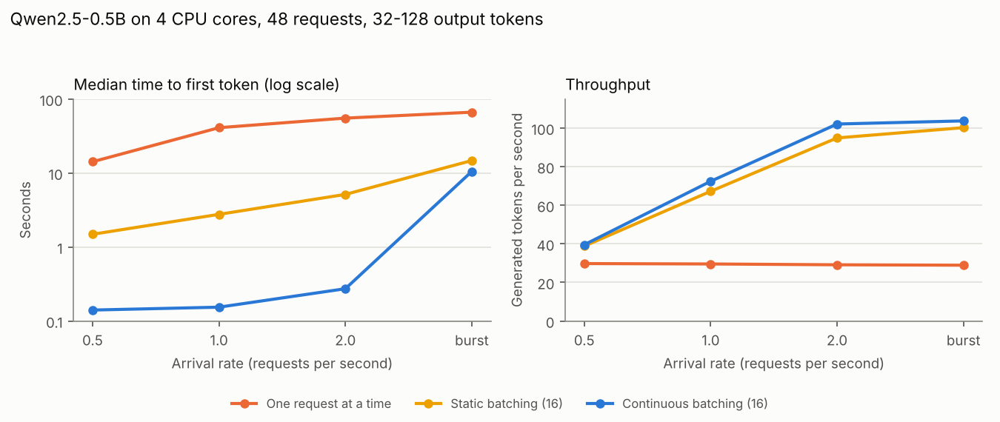

# Bitwise

[](https://github.com/tkran2/bitwise/actions/workflows/ci.yml)

An LLM inference engine in C++20 whose outputs are **bit-for-bit independent of how
requests are scheduled**. A request produces the same tokens, from the same logits
down to the last float bit, whether it ran alone or in a crowded batch, was chunked,
hit the prefix cache, was preempted and recomputed, or was decoded speculatively.

It serves real Llama- and Qwen2-architecture checkpoints (SmolLM2, Qwen2.5) on CPU with
AVX-512 kernels, and implements the usual serving machinery: a paged KV cache,
continuous batching, chunked prefill, prefix caching, recompute preemption and
speculative decoding. A deterministic trace simulator checks the invariance claim
against thousands of randomized workloads, and it caught all six bugs deliberately
injected to test it, plus one real livelock.

The core (`src/`, 1,900 lines) has no third-party dependencies.

## Why

Most inference stacks pick reduction strategies from the shape of the work: split-K
matmuls when the batch is small, split-KV attention when there are few queries,
different tilings for prefill and decode. Each choice is reasonable, and each makes
a request's floating-point results depend on what else happens to be in the batch.
Thinking Machines described the consequences in
[*Defeating Nondeterminism in LLM Inference*](https://thinkingmachines.ai/blog/defeating-nondeterminism-in-llm-inference/)
(Sept 2025): evaluations that are not reproducible, and RL that is not truly
on-policy because the sampler's numbers differ from the trainer's. vLLM and SGLang
have since added deterministic modes. This project builds the property in from the
first kernel and then tries hard to break it.

Measured on the same CPU with Qwen2.5-0.5B-Instruct, 16 requests run one at a time and
then together in one batch (`bench/hf_batch_variance.py`):

| Stack | Requests whose first-token logits changed when batched |
| --- | ---: |
| Hugging Face transformers (PyTorch CPU kernels) | 16 of 16 |
| Bitwise, shape-specialized kernels | 16 of 16 |
| Bitwise, invariant kernels | **0 of 16** |

In this sample the bit-level differences did not change any greedy token within 64
tokens; they surface as diverging continuations over longer generations and as
mismatched sampler and trainer log-probabilities in RL.

## How invariance is achieved

- **Matmul.** Weights are repacked into 16-wide column panels. Each output element
  is one fused multiply-add chain over `k = 0..K-1`, always. Wide batches and skinny
  batches only change how many outputs share a pass over `k` in registers (128 for a
  single row, 12 to 32 for larger tiles), which buys the instruction-level
  parallelism that split-K would otherwise provide, without changing any output's
  summation order. A portable scalar implementation using `std::fma` in the same
  order must agree with the AVX-512 kernel bit for bit, and the tests check it.
- **Attention.** A query at position `p` reduces over keys `0..p` in key order
  (scores, max, softmax sum, value accumulation), whether it arrives in a prefill
  chunk, a decode step or a speculative verify batch.
- **In-vector reductions** (dot products, sums of squares) use a fixed 16-lane split
  and a fixed reduction tree.
- **Compilation.** `-ffp-contract=off` and no fast-math, so the compiler cannot
  fuse or reassociate differently at different call sites.
- **Sampling** draws from a counter-based generator keyed by `(seed, position,
  stream)`, never from engine state, so preemption and recompute cannot shift the
  random stream.

`KernelMode::ShapeSpecialized` keeps the two common non-invariant optimizations
(split-K for skinny matmuls, split-KV attention for few queries) for comparison.

## Evidence

| Claim | How it was checked | Result |
| --- | --- | --- |
| Kernels are batch invariant | every row of a batched matmul and of batched attention compared with computing it alone, 1/3/4 threads | bitwise equal; shape-specialized mode differs, as designed |
| Vector and scalar kernels agree | AVX-512 vs portable `std::fma` reference over 480 shapes, F32 and BF16 | bitwise equal |
| Scheduling never changes a request's output | 2,000 randomized traces, 7,929 requests: shared and repeated prompts, cancellations, preemption under tight memory, token budgets of 4 to 64, speculation, static and continuous batching, 1 to 4 threads | 0 token or logit mismatches; 1,242 preemptions, 32,256 prefix-cache hit tokens, 30,368 accepted draft tokens |
| The simulator can catch real bugs | 6 bugs injected behind a test flag, 400 traces each | all 6 caught (table below) |
| Matches the reference implementation | logits vs Hugging Face transformers (fp32) on real prompts, Qwen2 and Llama architectures | max abs difference 2.2e-4 on logits up to ±29; 100% top-1 agreement |
| Real weights keep the guarantee | Qwen2.5-0.5B, 8 chat requests with a shared system prompt under continuous batching with preemption and prefix hits | identical tokens and logit fingerprints to running each alone |
| Greedy speculative decoding is lossless in bits | SmolLM2-135M drafting for SmolLM2-360M | identical tokens and logit fingerprints to plain decoding |
| Memory safety | unit tests and 400 simulator traces built with AddressSanitizer and UBSan (`-DBITWISE_SANITIZE=ON`) | clean |

### The simulator caught every injected bug, and one real one

`bitwise_sim --sweep-faults` runs the same randomized traces against deliberately
broken engines:

| Injected bug | Caught by | First failing trace |
| --- | --- | ---: |
| Prefix cache may cover the block holding the last prompt token | engine stalls (no logits to sample from) | 100 |
| Sampling randomness keyed by engine step instead of position | 553 token mismatches | 0 |
| On a greedy mismatch, the draft's token is kept instead of the target's | 19 token mismatches | 32 |
| A block is registered in the prefix cache before it is full | 38 token mismatches | 45 |
| Cancellation forgets to release the request's blocks | 68 leaked-block checks, 20 stalls | 1 |
| Shape-specialized kernels | 964 logit mismatches (tokens unchanged) | 1 |

Before any of that, the first run of the simulator found a real livelock: with a
token budget smaller than a speculative verify batch (budget 4, `k = 4` needs 5
rows), decode steps could never be scheduled. The engine now shrinks the draft
length to fit the budget, and that configuration is part of every run.

## Performance (CPU, 4 cores, AVX-512)

These are CPU numbers from a shared 4-core cloud VM; they show the engine's overhead
and how its scheduling features behave, not GPU-class throughput.

### Scheduling

48 chat requests (instructions from databricks-dolly-15k) with 32 to 128 output
tokens, Poisson arrivals, Qwen2.5-0.5B-Instruct (`bench/loadgen.py scheduling`):



| Arrival rate | Policy | Throughput | Median TTFT | p99 TTFT | Median end-to-end |
| --- | --- | ---: | ---: | ---: | ---: |
| 1 req/s | one at a time | 29.6 tok/s | 41.1 s | 86.4 s | 43.2 s |
| 1 req/s | static batching | 67.2 tok/s | 2.77 s | 7.74 s | 7.3 s |
| 1 req/s | continuous batching | 72.4 tok/s | 0.15 s | 0.29 s | 5.5 s |
| 2 req/s | static batching | 94.9 tok/s | 5.15 s | 12.4 s | 13.3 s |
| 2 req/s | continuous batching | 102.1 tok/s | 0.27 s | 6.39 s | 12.9 s |

Continuous batching admits a request on the step after it arrives instead of waiting
for the current batch to drain, which is where the 18x lower median time to first
token at 1 req/s comes from; throughput is similar because both keep the cores busy.

### Prefix caching

The same 48 requests behind a shared 254-token system prompt (280 prompt tokens on
average), 1 req/s:

| | Median TTFT | p99 TTFT | Throughput | Prompt tokens served from cache |
| --- | ---: | ---: | ---: | ---: |
| prefix caching off | 6.55 s | 15.2 s | 21.8 tok/s | 0 |
| prefix caching on | 0.15 s | 0.74 s | 27.5 tok/s | 12,032 |

Outputs are bit-identical with and without the cache (all 48 logit fingerprints match).

### Speculative decoding

Greedy, one stream at a time, SmolLM2-135M-Instruct drafting (`bench/loadgen.py spec`):

| Target | k | Tokens/s | Draft tokens accepted | Bit-identical to k = 0 |
| --- | ---: | ---: | ---: | :---: |
| SmolLM2-1.7B | 0 | 7.26 | | yes |
| SmolLM2-1.7B | 2 | 7.63 | 57% | yes |
| SmolLM2-1.7B | 4 | 7.06 | 42% | yes |
| SmolLM2-360M | 0 | 31.1 | | yes |
| SmolLM2-360M | 2 | 26.2 | 66% | yes |

On this CPU speculation is roughly break-even: +5% at k = 2 for the 1.7B target and
slower otherwise. Verifying k + 1 tokens costs noticeably more than decoding one,
because at these sizes CPU decoding is only partly memory-bound, and the 135M draft
agrees with the target about half the time. The property that matters here holds
regardless: every configuration produced exactly the same tokens and logits as plain
decoding.

### Kernels and baseline

| Measurement | Result |
| --- | --- |
| Cost of invariance, batch 1 decode | 31.0 vs 30.7 tok/s (invariant vs shape-specialized): none |
| Cost of invariance, batch 8 decode | 99.3 vs 104.3 tok/s: about 5% |
| Single-stream decode vs transformers | 29.0 tok/s vs 12.9 tok/s (Bitwise keeps weights in bf16 and computes in fp32; transformers ran in fp32) |

The near-zero cost on CPU is a finding, not an accident: four cores are kept busy by
splitting output columns, so nothing needs split-K. On a GPU with 100+ SMs and small
batches, split-K and split-KV are what fill the machine, which is where invariance
costs throughput.

## Build and run

```bash
cmake -S . -B build && cmake --build build -j
./build/bitwise_tests                      # unit tests, all bitwise checks
./build/bitwise_sim --traces 2000          # randomized schedule-invariance check
./build/bitwise_sim --sweep-faults --traces 400

pip install -r requirements.txt
python tools/convert.py Qwen/Qwen2.5-0.5B-Instruct models/qwen2.5-0.5b-instruct.bw
PYTHONPATH=python python -m pytest python/tests     # real checkpoints vs transformers
cd bench && PYTHONPATH=../python python loadgen.py kernels hf scheduling prefix spec
```

```python
import bitwise as bw
model = bw.Model.load("models/qwen2.5-0.5b-instruct.bw")
cfg = bw.EngineConfig(); cfg.max_batched_tokens = 256
engine = bw.Engine(model, None, cfg)
rid = engine.add_request(prompt_token_ids, bw.SamplingParams(temperature=0.7, seed=1, max_new_tokens=64))
while not engine.idle():
    engine.step()
print(engine.result(rid).tokens, hex(engine.result(rid).logits_fingerprint))
```

## Layout

```text
src/kernels.*        fixed-order AVX-512 matmul, RMSNorm, RoPE, SwiGLU, paged attention (+ scalar reference)
src/model.*          checkpoint loading, weight packing, batched forward pass over the paged cache
src/block_manager.*  reference-counted KV blocks, hash-chained prefix cache with token verification, LRU eviction
src/engine.*         scheduler, chunked prefill, preemption, sampling, speculative decoding, fingerprints
sim/simulate.cpp     deterministic trace simulator and fault sweep
tests/test_main.cpp  unit tests
python/              pybind11 bindings and real-checkpoint tests
tools/convert.py     Hugging Face safetensors -> .bw
bench/               load generator, batch-variance comparison
```

Not implemented: GPU kernels, quantized weights, top-k/top-p sampling, an HTTP server.

MIT license.
